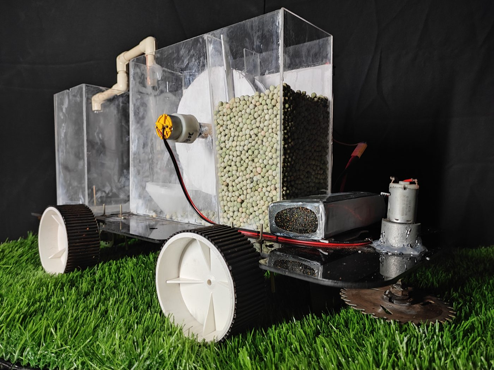
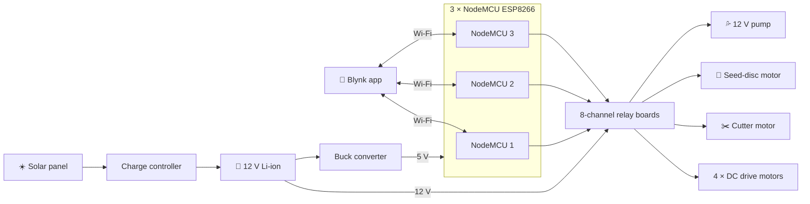
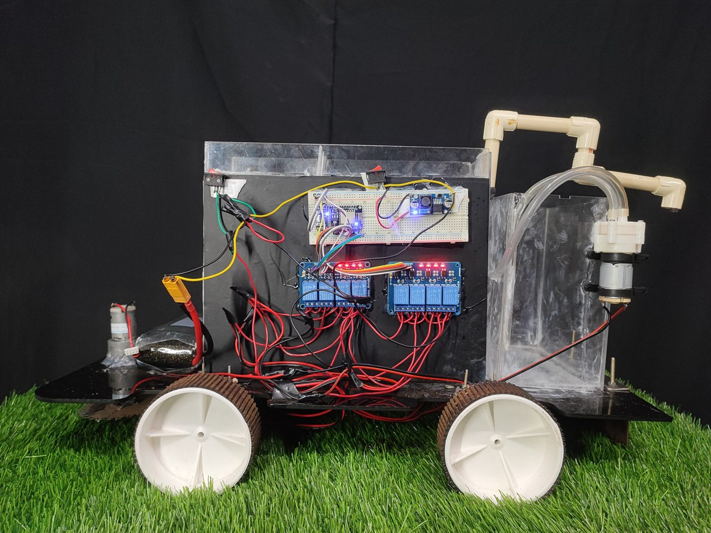
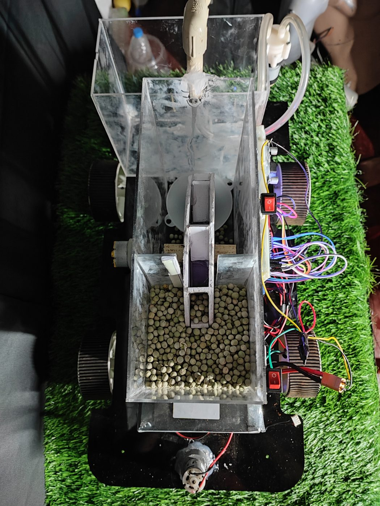
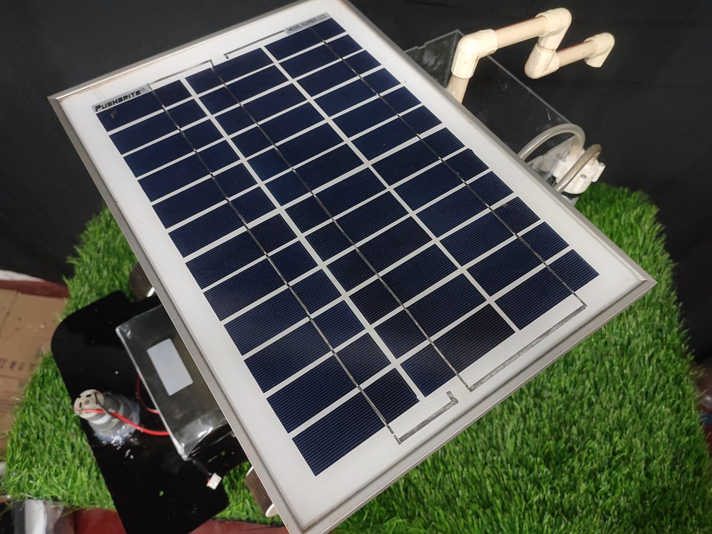
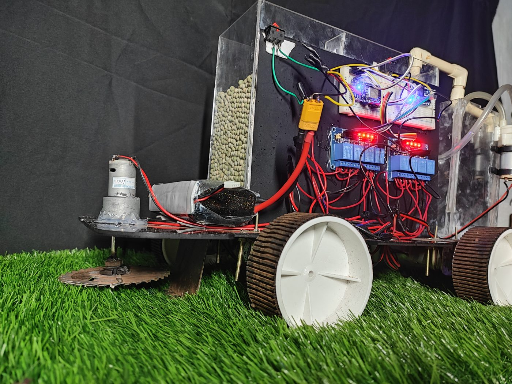
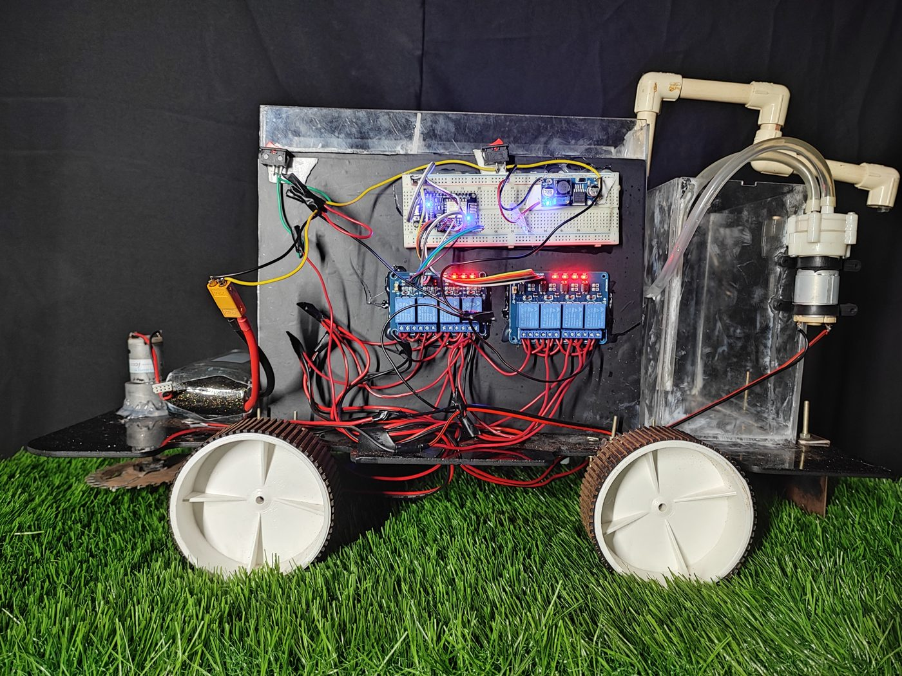
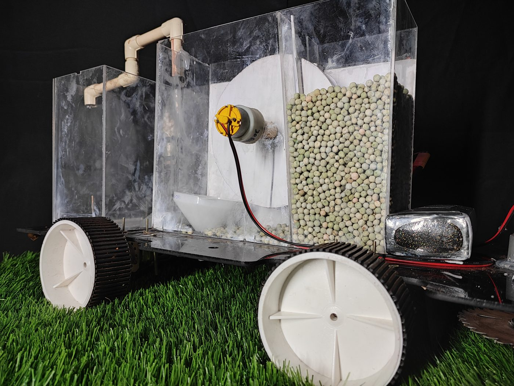

<div align="center">


### 🌱 Four farm jobs. One solar-charged robot. Controlled from a phone.


</div>

---

## 📌 At a glance

> A compact **multipurpose agriculture robot** that does four jobs farmers normally do by hand: **grass cutting, seed sowing, pesticide spraying and watering**. It runs on a **solar-charged battery** and is driven from a **phone dashboard over Wi-Fi** — no cables, no remote, no laptop.

<div align="center">
  
  <br/><sub><i>Seed hopper with rotary metering disc, spray tank and pump, front cutter — all on one laser-cut chassis</i></sub>
</div>

| 🗓️ Built | 💰 Funding | 🧠 My role | 🔋 Power |
|:---:|:---:|:---:|:---:|
| 2022 | AICTE IDEA Lab | Concept · circuit design · hardware integration | 12 V Li-ion + solar panel |

---

## 📑 Contents

- [The problem](#-the-problem)
- [Four tools on one robot](#-four-tools-on-one-robot)
- [How it works](#-how-it-works)
- [Hardware](#-hardware)
- [Mechanical design & fabrication](#-mechanical-design--fabrication)
- [Gallery](#-gallery)
- [Code](#-code)
- [Repository map](#-repository-map)
- [What I learned](#-what-i-learned)

---

## 🎯 The problem

On small farms, cutting, sowing, spraying and watering are still done by hand — slow, tiring work, and spraying exposes people to chemicals. Buying a separate machine for each job is out of reach for most small farmers.

**Goal:** one low-cost, modular robot that can do all four, powered by the sun and driven from a phone.

---

## 🧰 Four tools on one robot

<table>
<tr>
<td width="25%" align="center" valign="top">

### ✂️ Cutting
High-RPM DC motor with a guarded blade at the front trims grass as the robot drives.

</td>
<td width="25%" align="center" valign="top">

### 🌾 Sowing
An acrylic seed hopper feeds a **motor-driven rotary disc** that drops seeds at even intervals.

</td>
<td width="25%" align="center" valign="top">

### 💦 Spraying
A **12 V pump** pushes pesticide from the onboard tank through PVC lines to the nozzle.

</td>
<td width="25%" align="center" valign="top">

### 🚿 Watering
The same tank-and-pump circuit waters crops, switched on and off from the app.

</td>
</tr>
</table>

**Plus:**
- ☀️ **Solar panel** on top charges the battery through a charge controller while the robot works
- 📱 **One phone controls everything** — drive, cutter, seed disc and pump
- 🌡️ **Soil-moisture and temperature/humidity sensing** shown on the IoT dashboard

---

## 🔄 How it works



**Why relays instead of motor drivers?** Each motor only needs on/off and direction, so relay switching kept the electronics simple, cheap and easy to repair in the field. Driving is done by switching motor pairs: both sides forward, both reverse, or one side only to turn.

**Why three NodeMCUs?** The robot has more loads than one board has pins. The same firmware runs on all three boards with different Blynk virtual pins, and all three join the **same hotspot** — so one phone controls the whole robot.

---

## 🔌 Hardware

| Subsystem | Components |
|---|---|
| 🧠 **Controllers** | 3 × NodeMCU (ESP8266) |
| ⚡ **Switching** | 8-channel relay modules |
| 🏎️ **Drive** | 4 × 12 V DC geared motors, one per wheel |
| 🛠️ **Tools** | High-RPM cutter motor · seed-disc motor · 12 V diaphragm pump · PVC spray line |
| 🌡️ **Sensors** | Soil-moisture sensor · DHT temperature/humidity sensor |
| 🔋 **Power** | 12 V Li-ion pack · solar panel + charge controller · buck converter (5 V logic) |
| 📱 **Interface** | Blynk IoT dashboard on a smartphone |

---

## 📐 Mechanical design & fabrication

- 📏 Wheels, seed-sowing unit and tank panels were **drawn as DXF files** and **laser-cut**
- 🧪 Transparent acrylic for the hopper and tank, so seed level and liquid level are visible at a glance
- 🔩 Electronics mounted on one side panel for easy wiring and maintenance
- 📂 All cutting files are in this repo: [`dxf files/`](dxf%20files) (CAD) and [`rd files/`](rd%20files) (RDWorks laser jobs)

---

## 📸 Gallery

<table>
<tr>
<td width="50%"></td>
<td width="50%"></td>
</tr>
<tr>
<td align="center"><sub><b>Electronics panel</b> — relay boards and NodeMCUs</sub></td>
<td align="center"><sub><b>Top view</b> — seed hopper and metering disc</sub></td>
</tr>
<tr>
<td width="50%"></td>
<td width="50%"></td>
</tr>
<tr>
<td align="center"><sub><b>Solar panel</b> — charges the battery on the move</sub></td>
<td align="center"><sub><b>Front view</b> — cutter, hopper and wiring</sub></td>
</tr>
<tr>
<td width="50%"></td>
<td width="50%"></td>
</tr>
<tr>
<td align="center"><sub><b>Spray system</b> — tank, pump and PVC line</sub></td>
<td align="center"><sub><b>Rear view</b> — drive wheels and tank</sub></td>
</tr>
</table>

---

## 💻 Code

[`multipurpose_Agriculture_robot_code.ino`](multipurpose_Agriculture_robot_code/multipurpose_Agriculture_robot_code.ino) — each Blynk button switches one relay:

```cpp
#define relay1 D4          // 8 relays on NodeMCU pins D0–D7

BLYNK_WRITE(V0) {          // app button → relay
  int button = param.asInt();
  digitalWrite(relay1, button == 1 ? HIGH : LOW);
}

void loop() { Blynk.run(); }
```

| Virtual pins | Relays | Use |
|:---:|:---:|---|
| `V0` – `V7` | 1 – 8 | Drive motors and tools — mapped per NodeMCU |

<details>
<summary><b>▶ How to run it</b></summary>

1. Install the **ESP8266 board package** and the **Blynk** library in the Arduino IDE
2. Open the sketch and enter **your own** Blynk template ID, auth token and Wi-Fi name/password
3. Select **NodeMCU 1.0 (ESP-12E)** and upload — repeat for each board with its own virtual pins
4. Put all boards on the **same hotspot** so one phone controls the whole robot
5. Add eight buttons (`V0`–`V7`) to the Blynk dashboard

</details>

---

## 🗂️ Repository map

```
📦 Multipurpose-Agriculture-Robot-
 ┣ 📂 multipurpose_Agriculture_robot_code
 ┃ ┗ 📜 multipurpose_Agriculture_robot_code.ino   ← NodeMCU + Blynk relay control
 ┣ 📂 dxf files      ← laser-cut parts: wheels, seed-sowing unit, tank panels
 ┣ 📂 rd files       ← RDWorks laser-cutter jobs
 ┣ 📂 media          ← photos used in this README
 ┣ 📕 IMG_20220627_014237.pdf
 ┗ 📘 README.md
```

---

## 🧠 What I learned

- 🔗 **Integrating mechanics, power and IoT** into one machine that works outdoors
- ⚡ **Power design** — splitting a 12 V motor bus from a regulated 5 V logic rail, with solar charging
- ✂️ **Design for laser cutting** — going from DXF drawings to a finished acrylic body
- 📶 **Scaling IoT control** across several microcontrollers from one app

---

<div align="center">

### 👋 Built by **Ajay Arjun Mannolkar**
M.Sc. Mechatronics & Cyber-Physical Systems · THD Deggendorf

[](https://technolkar.github.io)
[](https://www.linkedin.com/in/ajaymannolkar)
[](https://www.youtube.com/@TechnolkarInnovations)

⭐ *If this project helped you, give it a star!*


</div>
